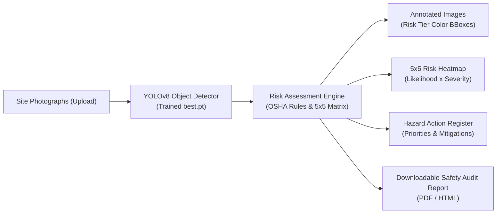

# AI Tool for Automated Hazard Identification and Risk Assessment on Construction Sites

**Department of Computer Science — BSc (Hons) Final Year Project**  
*Student:* **Serghei Coceban**  
*Institutions:* **University of Bolton & Regent College London**  
*Frameworks:* **YOLOv8 Computer Vision, OSHA 29 CFR 1926 Safety Regulations, 5×5 Risk Assessment Matrix**

---

## 🏗️ Project Overview

This system provides a practical, automated construction safety solution by processing standard site photographs, detecting physical hazards with deep learning (YOLOv8), evaluating risk using a rule-based 5×5 Likelihood × Severity matrix, and automatically compiling downloadable PDF/HTML safety audit reports with actionable mitigation instructions.



---

## 🚀 How to Deploy Your Trained Model (`best.pt`)

Since you already trained your model, deploying it into this project is very simple:

### Step 1: Copy your `.pt` weights
Copy your trained YOLOv8 weights file (typically saved in `runs/detect/train/weights/best.pt`) into the project's weights directory:
```bash
cp /path/to/your/best.pt models/weights/best.pt
```
*Note: If you name it `best.pt`, the system will automatically discover and load it on startup.*

*(Alternative: You can also launch the web app and upload `best.pt` directly via the sidebar **"Upload Custom Weights (.pt)"** tool).*

### Step 2: Install Dependencies
Open your terminal in the project directory:
```bash
cd /Users/bloemscheffer/Desktop/construction_hazard_ai
pip install -r requirements.txt
```
*(Dependencies include `ultralytics`, `torch`, `streamlit`, `opencv-python-headless`, and `reportlab`).*

### Step 3: Verify Your Custom Classes (in `config.py`)
YOLOv8 detects objects based on the class labels defined in your training dataset (e.g. `no_helmet`, `no_vest`, `missing_guardrail`, `unsafe_ladder`, etc.).

Check `config.py` to ensure your class names match or alias to the knowledge base:
```python
HAZARD_KNOWLEDGE_BASE = {
    "no_helmet": {
        "title": "Missing Hard Hat / Head Protection",
        "category": "PPE Violation",
        "default_likelihood": 4,   # 1 (Rare) to 5 (Almost Certain)
        "default_severity": 4,     # 1 (Negligible) to 5 (Catastrophic)
        "standard_ref": "OSHA 1926.100 / EN 397",
        "recommendation": "Provide certified hard hat immediately. Suspend worker until compliant."
    },
    # Add any extra hazard labels specific to your dataset here!
}
```

### Step 4: Launch the Web Application
Run the Streamlit application:
```bash
streamlit run app.py
```
The browser will automatically open at `http://localhost:8501`.

---

## 📊 5×5 Risk Assessment Matrix

The risk engine maps every detected hazard onto a standardized construction industry 5×5 matrix:

$$\text{Risk Score} = \text{Likelihood (1--5)} \times \text{Severity (1--5)}$$

| Score Range | Risk Tier | Action Priority | Timeframe for Mitigation |
|:---:|:---:|:---:|:---:|
| **15 – 25** | 🔴 **Critical** | Immediate Work Stoppage | Instant resolution before any personnel re-entry |
| **10 – 14** | 🟠 **High** | Urgent Rectification | Remedy within 1 hour; restrict access to danger zone |
| **5 – 9** | 🟡 **Medium** | Remedial Action | Rectify within current work shift |
| **1 – 4** | 🟢 **Low** | Routine Monitoring | Toolbox talks and standard supervision |

---

## 📁 Project Directory Structure

```text
construction_hazard_ai/
├── README.md                      <- Complete project documentation and guide
├── requirements.txt               <- Python dependencies (ultralytics, streamlit, etc.)
├── config.py                      <- Knowledge base, OSHA rules, 5x5 matrix scoring
├── app.py                         <- Streamlit Web Application (UI, multi-image upload, export)
├── test_system.py                 <- Automated pipeline self-test
├── models/
│   └── weights/
│       ├── README.md              <- Instructions for model weight placement
│       └── best.pt                <- Put your trained YOLOv8 weights here!
├── core/
│   ├── __init__.py
│   ├── detector.py                <- YOLOv8 inference engine (with demo fallback)
│   ├── risk_engine.py             <- 5x5 Risk Matrix & rule-based engine
│   ├── visualizer.py              <- Bounding box annotation & Matplotlib 5x5 heatmap
│   └── report_generator.py        <- ReportLab PDF & print-ready HTML audit reports
└── samples/
    └── sample_site.jpg            <- Ready-to-use sample site image for quick testing
```

---

## 🧪 Verification & Testing

You can run the self-test anytime to verify that all modules are operating cleanly:
```bash
python3 test_system.py
```
